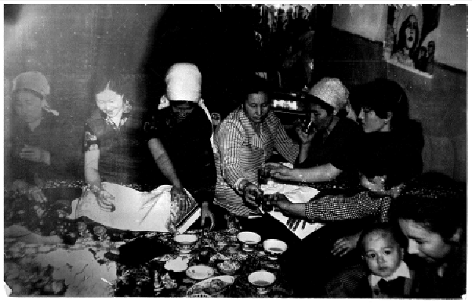
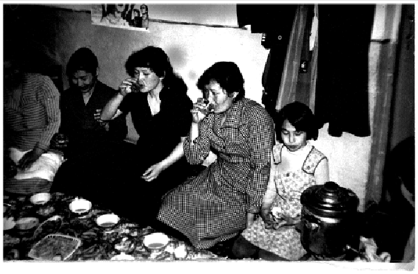
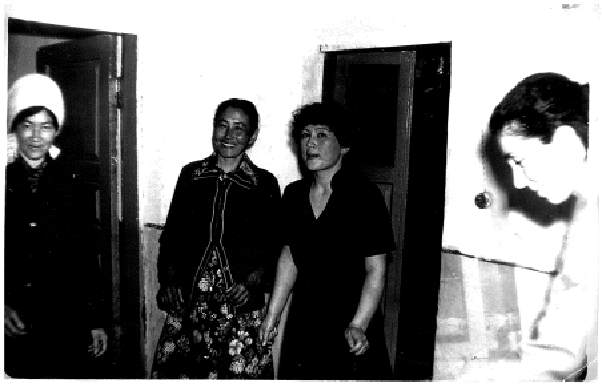
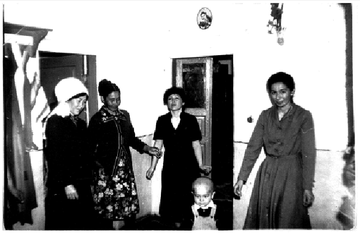

Поселок Джалагаш Кзылординской области, вторая половина 1980-х. На фотографиях моя тетя Райкуль среди своих коллег – акушерок, медсестер и санитарок. Празднование чьего-то дня рождения или новоселья. Некоторые женщины в платках, некоторые – без. На снимках ни одного мужчины. Тут и там мелькают дети. На полу накрыта скатерть. Чай разлит по пиалам. Вечер не без алкоголя: женщины дружно чокаются рюмками и отпивают из них. Не хватает только сестры-хозяйки Нины Александровны, наставницы Райкуль. Она учила тетю закрывать на зиму банки с соленьями, сажать цветы и печь пироги.

Райкуль – все зовут ее Раей – около тридцати лет. На первой фотографии она четвертая справа. Рая одета в сдержанное черное платье. Длинные волосы собраны в хвост, пышная челка обрамляет лоб. Четкий профиль, изящный овал лица, прямой нос. Несмотря на небольшой рост, Рая выделяется среди своих товарок умением держаться – прямо, чуть свысока. Моя мама, ее младшая сестра, вспоминая о ней, рассказывает: Рая была несгибаемой, упрямой, гордой. Но тем, кого любила, она была предана.

Этот ее стойкий, волевой, но вместе с тем не без высокомерия, характер был заметен с самого детства. Мальчик-первенец, родившийся до нее, не выжил, поэтому за новорожденной Райкуль следили с удвоенным вниманием. Ее бабушка, моя прабабушка, не разрешала никому смотреть на долгожданную внучку, скрывая ее за накидкой в колыбели. На удивление она родилась крупной, больше четырех килограмм, хоть и выросла потом миниатюрной женщиной.

Вопреки сложившимся обычаям, Рая – старшая дочь в семье – не тянула быт на себе. Она не была избалованной, но никогда не работала руками, предпочитая раздавать указания младшим сестрам и брату – убраться дома, вывести скот на пастбище, подоить корову.

Из четверых детей только Рая училась в казахоязычной школе. В восьмом классе классная руководительница отругала ее за то, что та якобы красится. На деле это был естественный румянец, горевший красным на щеках против воли его обладательницы. Свежесть юности не давала учителям житья, поэтому Рая ушла из школы и поступила в медучилище в городе – тогда еще Кзыл-Орде.

Ночами во время студенчества Рая переводила учебные материалы с латыни на русский, а затем – на казахский. Она писала домашним полные нежности письма и прикладывала фотокарточки с однокурсницами, сделанные в Доме Быта. Стараясь следовать моде, она шила себе платья, вдохновляясь последними выпусками “Работницы” и “Крестьянки”. Рая выписывала журнал “Кругозор” и собирала вложенные в него грампластинки. У нее была модная стрижка-каре под гремящую тогда на весь СССР Мирей Матье.

На этих фотографиях с домашней вечеринки у Раи уже есть сын, но он не знает о том, что она – его мать. Он был усыновлен своими бабушкой и дедушкой в младенчестве. Это семейный секрет, но все тайное рано или поздно становится явным.

Раю в ее двадцать один год по казахской традиции украл, чтобы жениться, мужчина, которого она толком и не знала. В ту ночь она молила свою мать поддержать ее и помочь сбежать, но та отказалась – побег означал позор для семьи. В день свадьбы во двор ее нового дома пробрался молодой человек, которого она любила. Они познакомились еще в городе, он учился на фельдшера. Прощание прошло в молчании.

Год спустя Рая родила сына, но еще через год развелась, – из-за насилия не только со стороны мужа, но и его отца. Когда родители Раи переписывали ее сына на свое имя, они надеялись, что это поможет ей выйти замуж во второй раз. Но этого так и не случилось.

В 1990 году, через несколько лет после того, как были сделаны эти фотографии, у Раи обнаружили опухоль головного мозга. В возрасте всего тридцати трех лет она пережила сложную операцию и осталась жива.

Следующие одиннадцать лет Рая – инвалид: она не может работать, ее мучают постоянные головные боли, она хромает на одну ногу. Периодически она проходит обследования, по госквоте ее отправляют в специальные санатории. Непрекращающаяся мигрень делает молодую женщину раздражительной и вспыльчивой. За ней ухаживают родители и моя мать – когда приезжает на выходные в аул.

***

В 1995 году мама рожает меня – без мужа. По этой причине ее мать, моя бабушка (дедушка скончался двумя годами ранее), отворачивается от дочери. Единственной, кто решается помочь маме, становится ее старшая сестра. Из аула в город приезжают хромающая Рая и ее сын Санко. Она и дает мне мое имя.

В безденежье после развала Союза Рая умудряется находить мясо и готовить супы. Она передает еду в роддом через Санко. Мама вспоминает: Санко – тогда еще шестнадцатилетний подросток, молчаливый, угрюмый – никогда не выкрикивает ее имя, чтобы та выглянула из окна палаты. Он стоит во дворе, долго выжидая, пока мама не догадается посмотреть наружу.

Рая – акушерка со стажем – в первое время после родов учит маму ухаживать за мной, пеленать, кормить. Позже они с Санко возвращаются домой, в аул. Спустя некоторое время бабушка наконец мирится с моей мамой и впервые знакомится со мной – ее годовалой внучкой.

Рая – я звала ее “Райкүл апа” – любит меня больше, чем других племянников. Она вяжет мне шерстяные носки и варежки. Когда я приезжаю в аул, бабушка чаще всего отсылает меня в комнату к Рае. Здесь интересно и весело – у нее тут тренажер-велосипед. Ей прописано заниматься на нем, но она всегда ленится. Я кручу на нем педали, воображая себя гонщицей. Рая лежит на своей односпальной кровати, с улыбкой смотрит на меня, а потом резко отворачивается. Я знаю, что случилось. Сильно закружилась голова – с ней такое часто. Останавливаюсь и иду к ней. Пристраиваюсь рядышком, она обнимает меня одной рукой. Я смотрю на паутину, висящую на потолке возле печи-контрамарки. Мне страшно, но тетя успокаивает – это всего лишь паучок.

Рая ушла слишком рано – в 44 года. Я помню поминки по ней, но ярче всего помню день ее смерти. Мне 6 лет, мы с мамой приехали в областную больницу – здесь Рая лежит уже несколько недель. Болезнь проявилась снова и прогрессирует. Но в этот раз ничего не помогает.

Врач сообщает новость маме, а та от горя оседает на пол. Я понимаю, что случилось что-то ужасное. Доктор говорит ей, что у Раи был плохой настрой, она сдалась и не хотела бороться. Мама кивает: да, вчера, когда мы ее навещали, она не хотела разговаривать и даже не повернула голову в нашу сторону. Молча смотрела в стену. Рая просто устала.

Полдень, на дороге у дома стоит катафалк. Сентябрь, но солнце в этих полупустынных краях печет как в середине июля. Из ворот на улицу выносят тело, обернутое в белый саван. За машиной рядами встали мужчины, сложив руки на груди. Мулла читает суру из Корана. Маму удерживают во дворе – женщинам туда нельзя. Тем более на погребение. Но она вырывается и взглядом провожает машину.

Санко всегда называл Раю по имени. Только к самому концу, когда она была прикована к постели, он впервые начал обращаться к ней: “мама”. Он молча обходит гостей, пришедших выразить соболезнования, с тазиком и кувшином для мытья рук. Слезы текут по его щекам.

В этой тишине слышно только мою маму. Она громко оплакивает судьбу сестры и все время приговаривает: “Еш қуаныш көрмей кетті! Құдайым-ау, не үшін соншама қинадын оны?[^1]”.

Слова мамы, сказанные на похоронах Раи, навсегда застревают в моей памяти. Неужели и правда Райкүл апа никогда не видела радости? Несмотря на испытания, посланные ей, наверняка были и в ее жизни дни, минуты, мгновения, наполненные счастьем?

На последней фотографии она, не улыбаясь, смотрит прямо в объектив. Даже танцуя, Рая будто не выражает никаких эмоций веселья, которым она должна была заразиться. О чем она думает? Тяготит ли ее, что скоро она вернется домой к сыну, которого ей приходится называть братом? Смогла ли она полностью прожить несправедливость, что случилась с ней? Влюблена ли она в кого-нибудь? Строит ли планы? Предчувствует ли надвигающийся недуг?

Я задаюсь этими вопросами, пока слезы душат меня. Долго перебираю снимки, разглядывая каждый. Я храню надежду, что Рая в этот вечер смогла забыть о невзгодах и насладиться компанией подруг. Мне хочется верить, что она все же смеялась, даже если фотограф не сумел поймать эти моменты.

[^1]: Ушла, так и не увидев счастья и радости! Боже, зачем так мучил ее?
